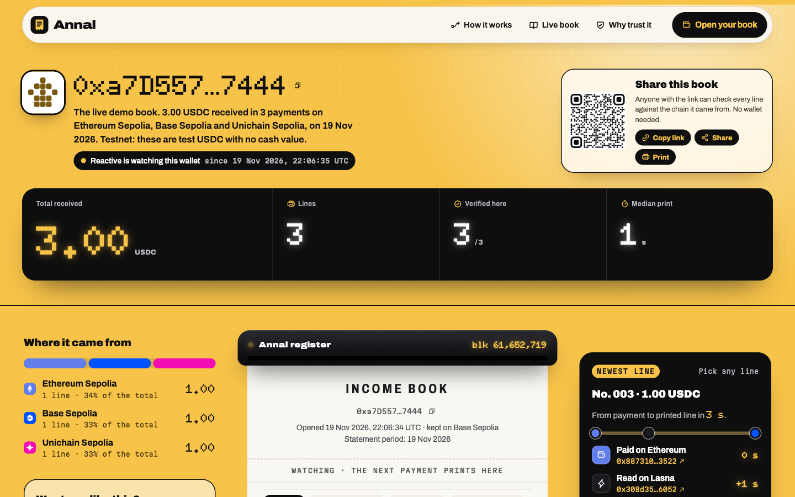

# Annal

**One income book for every chain you're paid on. Every line is copied from the payment's own log, and links back to it.**

On testnet that means Circle USDC on Ethereum Sepolia, Base Sepolia and Unichain Sepolia, kept in one book on Base Sepolia and written only by a Reactive Network contract on Lasna.

[](https://youtu.be/EggEfW50Ets)
[](https://annal-sooty.vercel.app)
[](https://annal-sooty.vercel.app/book/0xa7D557BF0C7312EAF186a6A81159a3650aA77444)
[](contracts/test/Annal.t.sol)
[](https://repo.sourcify.dev/84532/0x653B62A39Aea06998c152b48F150175B2645c8Bd)
[](https://repo.sourcify.dev/5318007/0x653B62A39Aea06998c152b48F150175B2645c8Bd)
[](LICENSE)

[Watch the film (2:30)](https://youtu.be/EggEfW50Ets) · [Live app](https://annal-sooty.vercel.app) · [Demo book](https://annal-sooty.vercel.app/book/0xa7D557BF0C7312EAF186a6A81159a3650aA77444) · [Verify it yourself](#verify-without-trusting-this-readme) · [How it works](#how-it-works) · [Evidence ledger](docs/EVIDENCE.md) · [Run it locally](#run-it-locally)



**The film, 2:30:** a fresh wallet opens a book, two payments on Unichain and Base Sepolia print on camera, a look-alike "USDC" and the owner's forged write are refused, and a reader checks the book on a phone with no wallet. Every transaction in it is real ([E-012](docs/evidence/E-012-film-take.txt)). [youtu.be/EggEfW50Ets](https://youtu.be/EggEfW50Ets)

## The problem

A freelancer paid in USDC on several chains sometimes has to prove that income to someone who doesn't trust them: a landlord, an accountant, a visa officer. A screenshot can be edited. A spreadsheet can be typed. An explorer link shows one chain at a time, and lists any token that calls itself "USDC". An off-chain indexer can merge the chains, but then the reader has to trust whoever runs the indexer.

Annal keeps the book on-chain and lets nobody write in it, the owner included. The owner opens a book with one transaction. From then on a Reactive Network contract watches Circle's USDC on each chain for transfers to that wallet, and writes each one into the book through Reactive's callback proxy, copied field by field from the payment's own log. The reader opens a link: no wallet, and every line is re-checked against its origin chain in their browser.

## Proof: nothing here is a mockup

Everything below is live. Click it.

| What | Where |
| --- | --- |
| The app | [annal-sooty.vercel.app](https://annal-sooty.vercel.app) (server-rendered from the chain, re-read live) |
| A real book: 3 lines, 1 USDC each from three chains | [`/book/0xa7D5…7444`](https://annal-sooty.vercel.app/book/0xa7D557BF0C7312EAF186a6A81159a3650aA77444) |
| AnnalReactive, on Reactive Lasna (5318007) | [`0x653B…c8Bd` on Reactscan](https://lasna.reactscan.net/address/0x653B62A39Aea06998c152b48F150175B2645c8Bd) · [verified source](https://repo.sourcify.dev/5318007/0x653B62A39Aea06998c152b48F150175B2645c8Bd) |
| AnnalBook, on Base Sepolia (84532) | [`0x653B…c8Bd` on Blockscout](https://base-sepolia.blockscout.com/address/0x653B62A39Aea06998c152b48F150175B2645c8Bd?tab=contract) · [verified source](https://repo.sourcify.dev/84532/0x653B62A39Aea06998c152b48F150175B2645c8Bd) |
| Every claim and the transaction behind it | [`docs/EVIDENCE.md`](docs/EVIDENCE.md), with raw receipts in [`docs/evidence/`](docs/evidence/) |

The two contracts share an address because each was the deployer's first deployment on its own chain, and a contract's address depends only on the deployer and that count.

### One payment, three transactions

Each line in the book is the end of a trail you can follow. These are the demo book's three lines (all status 1):

| Line | Paid on (origin) | Read on Lasna (reactive tx) | Written on Base Sepolia (callback) | Block to line |
| --- | --- | --- | --- | --- |
| No. 001 · 1 USDC | [Base Sepolia `0xc2a4…963f`](https://sepolia.basescan.org/tx/0xc2a4ea51d5862f2436c559edfc4f06f54c1aef04200162cb48c3f981fe3d963f) | [`0x8c0c…d7d7`](https://lasna.reactscan.net/tx/0x8c0c16ffcc4c0bb15325bb6731a1ac114e198d9c4c3c4bfa82d690709c3bd7d7) | [`0xfe41…2b43`](https://sepolia.basescan.org/tx/0xfe416c8a8900ee717631c953797f7ae50e77930b76ce5c5ace9d7557cbcd2b43) | 1 s |
| No. 002 · 1 USDC | [Unichain Sepolia `0xe86c…8f72`](https://sepolia.uniscan.xyz/tx/0xe86c31fe81adb62d36fade316ae3a735a5e0cfbd668f1570e5d5dfe7dc928f72) | [`0x37fd…33a2`](https://lasna.reactscan.net/tx/0x37fdfcefa0cfdbe349276a3108fc156d7d037d87fadc2ecd332384b0e4b033a2) | [`0xd475…1632`](https://sepolia.basescan.org/tx/0xd475c679eb10029e02ca958ee9acf701f5956a0f77f528971ce9097b98ca1632) | 1 s |
| No. 003 · 1 USDC | [Ethereum Sepolia `0x8873…3522`](https://sepolia.etherscan.io/tx/0x887310bc0673f6d4b3aae5fe4cb4e7b634b002fc63818bbc3b78e592d3fa3522) | [`0x308d…6052`](https://lasna.reactscan.net/tx/0x308d35c722d1862f6ebca6e42757978b10d3fc05c3f96f3354fdf070149b6052) | [`0x8487…36af`](https://sepolia.basescan.org/tx/0x84874b2c970f0b3dbf87a18c0996f7c8e55d7b24e823fe2249a704a3cfc736af) | 3 s |

Testnets can reset. The raw receipts for all of these are in [`docs/evidence/receipts/`](docs/evidence/receipts/).

### What it refuses

- **A look-alike "USDC".** A token deployed with `name` "USD Coin", `symbol` "USDC" and 6 decimals sent 500 to the demo wallet ([`0x811b…5b32`](https://sepolia.basescan.org/tx/0x811b5dcce5555c96c330d7d3e0dd26931614679c47d7311808b1ef2981f05b32)). Explorers list it. The book never printed it: the reactive contract is subscribed only to Circle's USDC contracts, and the book itself refuses any other source. The book page shows it struck through, under "Seen by explorers, not printed".
- **A forged write, even from the book's owner.** The demo wallet called `record` directly with a forged line, and the transaction was mined and reverted with `NotAuthorized` ([`0x7e57…c7ce`](https://sepolia.basescan.org/tx/0x7e5721dca9c662484aa78d5873bcc24b69fa8e3be170b4bc39189b951e33c7ce)). Neither contract has an owner or an admin function.

### How fast, measured

A [harness](harness/latency.ts) sent 24 real Circle USDC payments, 8 on each chain, to one opened book and read every line back. All 24 printed, none were missed, and every printed field equals the origin receipt. Time is the line's `writtenAt` minus the origin block's timestamp:

| Origin | Payments | Median | Slowest |
| --- | --- | --- | --- |
| Base Sepolia | 8 | 1 s | 2 s |
| Unichain Sepolia | 8 | 1 s | 2 s |
| Ethereum Sepolia | 8 | 2 s | 3 s |
| All | 24 | 1 s | 3 s |

Base-to-Base times are exact (6 to 9 Base blocks of 200 ms). Each chain keeps its own clock, so cross-chain times carry about one second of skew. Raw rows: [`docs/evidence/harness/`](docs/evidence/harness/). Re-run it with `npm run harness:latency -- --runs 24 --to <an opened book>`.

## Verify without trusting this README

Read-only. No wallet, no keys, only [Foundry's `cast`](https://getfoundry.sh).

```bash
BOOK=0x653B62A39Aea06998c152b48F150175B2645c8Bd      # AnnalBook on Base Sepolia
REACTIVE=0x653B62A39Aea06998c152b48F150175B2645c8Bd  # AnnalReactive on Lasna (same address, other chain)
DEMO=0xa7D557BF0C7312EAF186a6A81159a3650aA77444

# The demo book has 3 lines totalling 3.00 USDC (6 decimals)
cast call $BOOK "lineCount(address)(uint256)" $DEMO --rpc-url https://sepolia.base.org
cast call $BOOK "totalReceived(address)(uint256)" $DEMO --rpc-url https://sepolia.base.org

# Line 2 is the Ethereum Sepolia payment, log index 223, copied exactly
cast call $BOOK "lineAt(address,uint256)((address,uint256,uint256,address,uint256,uint256,uint256,bytes32))" \
  $DEMO 2 --rpc-url https://sepolia.base.org

# Real USDC is a source, the look-alike is not
cast call $BOOK "isSource(uint256,address)(bool)" 84532 0x036CbD53842c5426634e7929541eC2318f3dCF7e --rpc-url https://sepolia.base.org
cast call $BOOK "isSource(uint256,address)(bool)" 84532 0x4D2579b6E0f6273618Cd95Ff57Ae07653E9106Ca --rpc-url https://sepolia.base.org

# Writing by hand is refused: reverts with NotAuthorized (selector 0xc55ddc97)
cast call $BOOK "record(address,address,address,uint256,uint256,address,uint256,uint256,uint256)" \
  $BOOK $DEMO $DEMO 1000000000 84532 0x036CbD53842c5426634e7929541eC2318f3dCF7e 1 1 0 \
  --from $DEMO --rpc-url https://sepolia.base.org

# The reactive contract on Lasna is watching the demo wallet, and owes nothing
cast call $REACTIVE "watching(address)(bool)" $DEMO --rpc-url https://lasna-rpc.rnk.dev/
cast call 0x8888888888888888888888888888888888888888 "debt(address)(uint256)" $REACTIVE --rpc-url https://lasna-rpc.rnk.dev/
```

The contract tests, from a clean clone, with no keys and no RPC:

```bash
git clone --recurse-submodules https://github.com/ola-akanbi/annal && cd annal/contracts
forge test   # 21 tests
```

They cover the failure paths, not only the happy one: a forged direct `record`, a callback from a different reactive contract, a fake USDC, real USDC on a chain that isn't a source, a payment to an unwatched wallet, an unopened book, a duplicate delivery written once, and a 256-run fuzz that any amount and payer is copied exactly. See [`contracts/test/Annal.t.sol`](contracts/test/Annal.t.sol).

## How it works

```text
 Ethereum Sepolia ─┐  Circle USDC Transfer(to = owner)
 Base Sepolia ─────┼──────────────────────────────────▶  AnnalReactive (Lasna)
 Unichain Sepolia ─┘                                      react() → requestCallback
                                                                  │
                                         Reactive callback proxy  ▼
                                                     AnnalBook (Base Sepolia)
                                                     record(): one line, read by anyone
```

1. **Open.** The owner calls [`open()`](https://github.com/ola-akanbi/annal/blob/0b7c4b62c8b12cf7f63cfa45fd1c4a36c2f593df/contracts/src/AnnalBook.sol#L75-L79) on AnnalBook, which emits `BookOpened`. AnnalReactive subscribed to that event [at deployment](https://github.com/ola-akanbi/annal/blob/0b7c4b62c8b12cf7f63cfa45fd1c4a36c2f593df/contracts/src/AnnalReactive.sol#L53).
2. **Watch.** On `BookOpened`, [`_watch`](https://github.com/ola-akanbi/annal/blob/0b7c4b62c8b12cf7f63cfa45fd1c4a36c2f593df/contracts/src/AnnalReactive.sol#L88-L107) subscribes to Circle USDC `Transfer` logs whose `to` is that wallet, on each source chain, then calls back `confirmWatching` so the book shows "watching" without anyone pressing a button.
3. **Copy.** On a matching transfer, [`react`](https://github.com/ola-akanbi/annal/blob/0b7c4b62c8b12cf7f63cfa45fd1c4a36c2f593df/contracts/src/AnnalReactive.sol#L67-L80) checks the source and that the wallet is watched, and [`_copy`](https://github.com/ola-akanbi/annal/blob/0b7c4b62c8b12cf7f63cfa45fd1c4a36c2f593df/contracts/src/AnnalReactive.sol#L109-L128) requests a callback carrying the log's payer, amount, chain, token, block, tx hash and log index.
4. **Write.** [`record`](https://github.com/ola-akanbi/annal/blob/0b7c4b62c8b12cf7f63cfa45fd1c4a36c2f593df/contracts/src/AnnalBook.sol#L95-L136) accepts the call only from Reactive's callback proxy on behalf of AnnalReactive (`onlyServiceProvider`, `onlyCallbackSender`), only for an opened book and a known source, and writes each origin log once.
5. **Read.** The app server-renders the book from AnnalBook, re-reads it live, and in the reader's browser fetches each line's origin receipt to check that it holds the matching log.

**Why Reactive is load-bearing.** Take Reactive away and something has to watch three chains and decide what gets written. That would be a server, and its operator could write anything into the book. With Reactive, the watcher is a contract with no owner, its subscriptions are on-chain, and the book accepts lines from nowhere else. The reader trusts code they can read, not a person.

**Cost.** Each payment costs about 0.015 lREACT on Lasna and about 0.0000013 ETH for the callback on Base Sepolia. AnnalReactive pays from its own balance, and anyone can top it up.

## Run it locally

```bash
git clone --recurse-submodules https://github.com/ola-akanbi/annal && cd annal
npm install
npm run dev          # http://localhost:3000, reading the live testnet contracts
npm run gate         # lint (no warnings), typecheck, build, forge fmt/lint/build/test
```

Node 26, Next.js 16, viem, Foundry 1.8.3, Solidity 0.8.29, [`reactive-lib-omni`](contracts/lib/). Addresses, chain IDs and RPCs live in one module, [`src/lib/annal.ts`](src/lib/annal.ts). To deploy your own pair, see [`contracts/script/deploy.sh`](contracts/script/deploy.sh) (Foundry keystore only, never a raw key).

## Limits

- **Testnet only.** The USDC is Circle's test USDC, with no cash value. Nothing here is audited.
- **USDC only.** Plain ETH transfers emit no log, so there is nothing to copy.
- **Three sources, fixed at deployment.** Adding a chain means deploying a new pair.
- **No completeness promise if the watcher runs dry.** If AnnalReactive runs out of lREACT, payments made meanwhile are not printed, and the book page says so. The explorers' comparison on each book lists anything it left out.
- **A line records a payment, not its reason.** A self-payment from a second wallet prints like any other.
- **CI runs by hand.** The repo owner's GitHub Actions are billing-locked, so the workflows are manual and the gate of record is `npm run gate` before every push ([D-011](docs/DECISIONS.md)).

## Repository

```text
contracts/   AnnalReactive (Lasna) and AnnalBook (Base Sepolia), Foundry tests, deploy script
src/         Next.js app: landing, /book/[address], link previews, in-browser receipt checks
harness/     latency run with real payments across the three chains
docs/        STATE, PLAN, DECISIONS, EVIDENCE (claims and proofs), CONTEXT (verified dependency facts)
```

MIT licensed.
